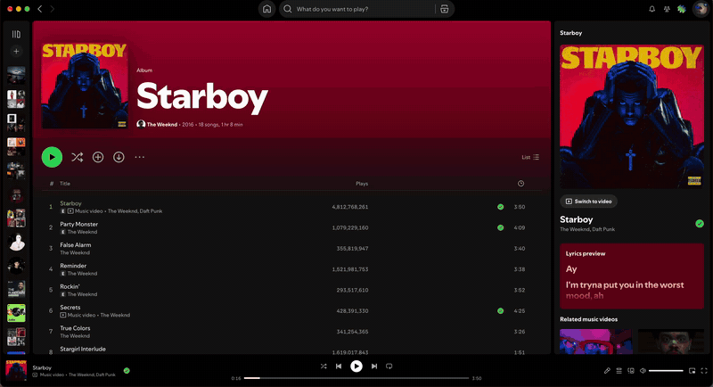
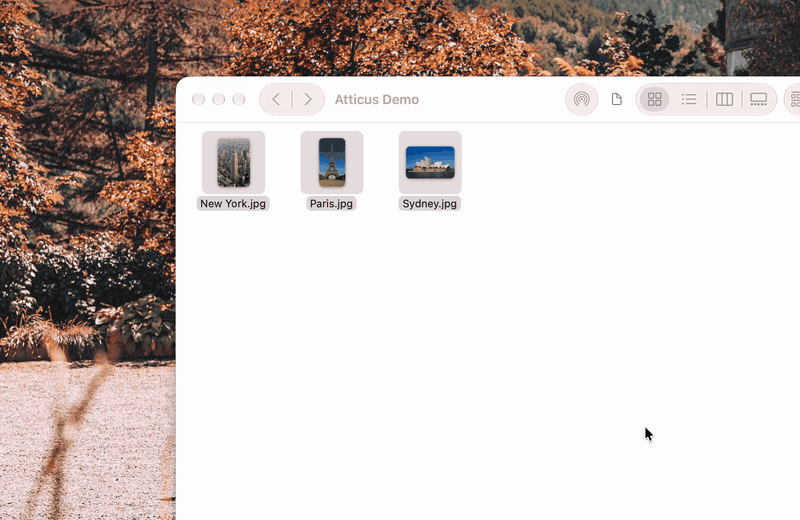

<p align="center"></p>

<p align="center">
  Hold <kbd>⌃ control</kbd> <kbd>⌥ option</kbd> <kbd>space</kbd>, say what you need, let go.<br>
  Atticus moves your windows, finds your files, reads your screen and gets it done.
</p>

<p align="center"><a href="https://ko-fi.com/saarthr"><b>☕ Leave a tip</b></a> · Atticus is free; tips keep it going.</p>

<p align="center">
  <b>🧠 Learns as you use it</b> &nbsp;·&nbsp; <b>⚡ Fast</b> &nbsp;·&nbsp; <b>🔑 No API key</b> &nbsp;·&nbsp; <b>Free and open source</b>
</p>

https://github.com/user-attachments/assets/26822ad2-6281-477d-b676-2f490a4a207b

<br>

## Circle it. Ask about it.


*"What is this?"* Hold the shortcut, circle anything on your screen and ask. Atticus looks at what you circled and answers.
Works on photos, pages, code, anything you can see.

<br>

## And it does the work

<table>
  <tr>
    <td width="50%" valign="top">
      
      <h3>Arrange windows</h3>
      <i>"Spotify on the left, Chrome on the right."</i><br>
      Atticus moves and sizes your windows in one go.
    </td>
    <td width="50%" valign="top">
      
      <h3>Hand off a job</h3>
      <i>"Turn these photos into one PDF."</i><br>
      An agent does the whole job in the background and hands you the file.
    </td>
  </tr>
</table>

## Install

```
curl -fsSL https://raw.githubusercontent.com/SaarthurR/atticus-mac/main/install.sh | bash
```

Needs **macOS 26** and an AI client: Claude Code on a Claude plan, Devin, Pi or a local model. Nix: `nix run github:SaarthurR/atticus-mac` (Nix installations show this update path in Settings). More in the [install guide](docs/GUIDE.md#install).

## Just ask

| You say | Atticus |
|---|---|
| *"Code on my big screen, Chrome and Terminal on the laptop."* | Arranges three windows across two displays. |
| *"Open Spotify."* · *"Terminal on the left."* | Runs instantly, with no AI at all. |
| *"Play Blinding Lights by The Weeknd."* | Starts it in Spotify in about a second. |
| *"Find my notes about the Tokyo trip."* | Searches your files by what's inside them. |
| *"What's wrong with this code?"* | Looks at your screen and answers in a line. |
| *"Move my dentist appointment to 4."* | Shows the change on a card. Adding is immediate; moving or deleting asks first. |
| *"Find me a desk lamp under $30 on Amazon."* | Works in Chrome behind your apps. |
| *"Where do I turn on Night Shift?"* | Points at the exact spot on your screen. |
| *"When I say focus mode, close Slack and open my to-do list."* | Remembers it. Next time, two words do it all. |

## What it does

- **Learns.** Ask once and it works out the steps. Ask again and it runs in a blink, with no AI.
- **Sees your screen.** Ask about anything on it. Point or circle with your mouse while you hold the shortcut, or use **Point at your screen** to mark a spot first.
- **Teaches and draws.** "Teach me…" points at each spot, one step at a time. "Explain this and draw it" builds a labeled diagram over your screen.
- **Picks the right model.** Easy asks go to a quick model; harder ones go to a stronger one. Change it in Settings → Intelligence.
- **Dictate anywhere.** Hold fn, talk, let go. Your words land in any text field, cleaned up.
- **Hands-free.** Turn on the wake word and just say "Atticus".
- **Background agents.** Big jobs run behind your apps while you keep working.
- **Meeting Copilot.** Answers and notes during calls, saved on your Mac.
- **Watch and routines.** "Tell me when Codex is done." "Every weekday at 8, summarize my calendar."
- **Your plan, no API key.** Runs on Claude, Devin, Pi or a [local model](docs/GUIDE.md#use-a-local-model).
- **Private and safe.** Your voice stays on your Mac. Deletes, sends and purchases ask first.

Every feature in detail: **[the guide](docs/GUIDE.md)**.

> **On Windows?** [@FindlayHi](https://github.com/FindlayHi) built **[Atticus for Windows](https://github.com/FindlayHi/atticus-windows)**.

## Privacy

Speech is turned into text on your Mac, and audio never leaves it. Anonymous usage counts send a random ID and feature names, never your words, files or screen. Turn them off in Settings → Account & Access. [Full details](docs/GUIDE.md#anonymous-usage).

## Contributing

Clone the repo and run `./build.sh` after each change. Tests: `python3 atticus.py --selftest` and `python3 -m unittest discover -s tests -v`, with a scratch `ATTICUS_DIR`. Keep personal settings, credentials and runtime state out of commits.

- `Atticus.swift`: the app (hotkey, speech, overlay)
- `atticus.py`: the brain (fast commands, system prompt, helpers)
- `ui/`: the overlay, setup and Settings pages

## License

MIT. See `LICENSE`. `ui/orbs.js` is from [thinking-orbs](https://github.com/Jakubantalik/thinking-orbs) (MIT, Jakub Antalik). Hands ideas adapted from [Plip](https://github.com/hussainn7/plip-oss) (MIT) and [Cua Driver](https://github.com/trycua/cua) (MIT).
